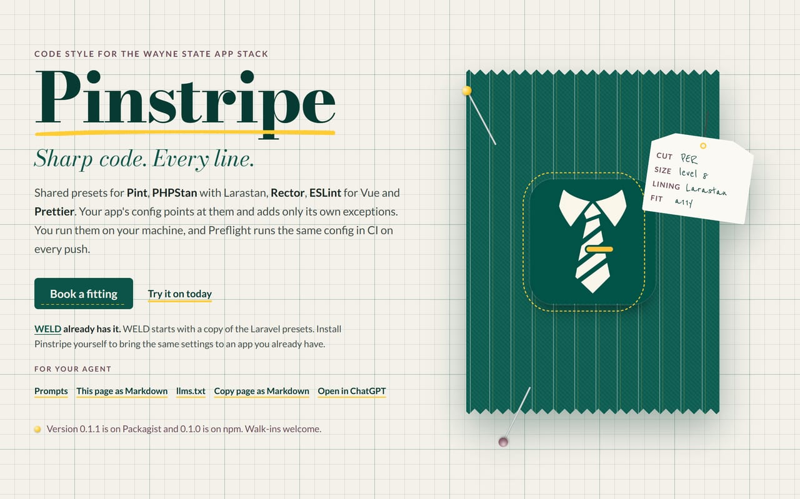
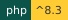
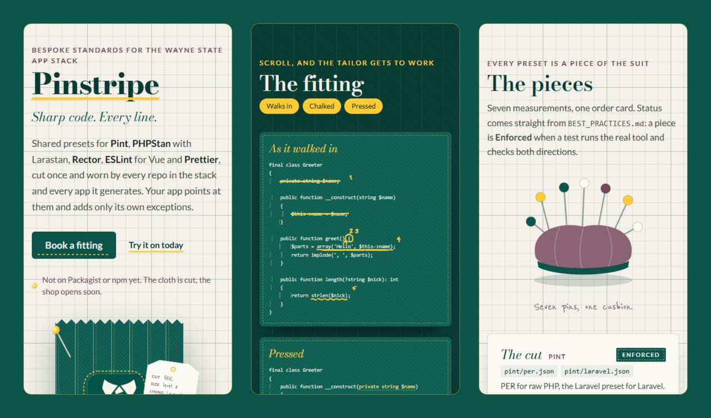
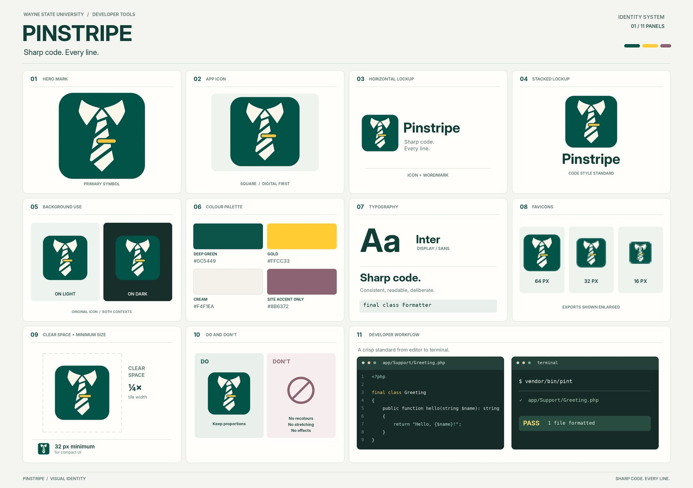

<div align="center">
  <a href="site/index.html"></a>
</div>

# Pinstripe

<p>
  
  
  
  <a href="https://github.com/waynestate/pinstripe/actions/workflows/ci.yml"></a>
</p>

**Sharp code. Every line.**

The coding standard for the Wayne State app stack: shared presets for Pint, PHPStan (with Larastan for Laravel), Rector,
and ESLint with Prettier. Your app points at them and adds only its own exceptions. Pinstripe is to code what a good
suit is to a job interview: nobody notices it, everybody notices when it's missing.

Checks: `composer ci` (the same command runs on GitLab and GitHub).

Development happens on Wayne State's GitLab; this repository is a release mirror. Changes land there first.

Front page: [`site/index.html`](site/index.html), a static tailor's shop you can open in a browser or serve from `site/`.
On Citadel it is served by the raw-PHP deploy layer in [`deploy/`](deploy/): a SQUIRE kit whose front controller serves `site/` behind HELMET's security headers. For local development, keep serving `site/` directly.

<div align="center">
  
</div>
<div align="center"><sub>Seven pieces, one tape. Every mark is read from the preset files in this repo; with reduced motion on, the tape stays unrolled.</sub></div>

<details>
<summary><b>Try it on</b>: three cuts from <code>site/</code> at phone width</summary>
<br>
<div align="center"></div>
</details>

<details>
<summary><b>The pattern book</b>: the brand board</summary>
<br>
<div align="center"></div>
</details>

## Use it in a raw PHP app

Add Pinstripe as a dev dependency:

```
composer require --dev waynestate/pinstripe:^0.1
```

Pinstripe 0.1.1 is on Packagist, and the npm package, `@waynestate/pinstripe`, is at 0.1.0.

Point PHPStan at the raw config. `phpstan.neon`:

```neon
includes:
    - vendor/waynestate/pinstripe/phpstan/raw.neon

parameters:
    paths:
        - app
```

Add Composer scripts that run on every OS:

```json
{
    "scripts": {
        "lint": "pint --test --config vendor/waynestate/pinstripe/pint/per.json",
        "fix": "pint --config vendor/waynestate/pinstripe/pint/per.json",
        "analyse": "phpstan analyse"
    }
}
```

`composer lint` fails on style. `composer fix` fixes it. Pint's `per` preset is the PER Coding Style, and `tests/fixtures/per` keeps a clean and a messy proof.
`composer analyse` runs PHPStan at level 8, with deprecation checks too.
Pinstripe ships `phpstan/phpstan-deprecation-rules`, loaded automatically by
`phpstan/extension-installer`. Calling a `@deprecated` method fails the build.
The tailor flags the old cut before the fabric is retired.

## Use it in a Laravel app

Same, with the Laravel parts:

```
composer require --dev waynestate/pinstripe:^0.1 larastan/larastan
```

Pinstripe pulls in `phpstan/extension-installer`, which registers Larastan for you. When Composer asks, allow the
plugin (`config.allow-plugins` in your `composer.json`). Your `phpstan.neon` includes
`vendor/waynestate/pinstripe/phpstan/laravel.neon` and nothing else: there is no Larastan line to add, and the
scripts point at `vendor/waynestate/pinstripe/pint/laravel.json`.

Proven on Laravel: `composer ci` lints a minimal Laravel 13 app (`tests/fixtures/laravel-app`) with
`pint/laravel.json` and analyses it with `phpstan/laravel.neon` on every run, and fails if the app stops
passing. A smaller fixture (`tests/fixtures/laravel`) proves the preset really loads Larastan: it plants an
undefined Eloquent property that only Larastan reports, and a clean twin it leaves alone.

## Use it for Vue

Add Pinstripe as a dev dependency:

```
npm install --save-dev @waynestate/pinstripe eslint prettier
```

Create `eslint.config.js` and spread the preset. For TypeScript:

```js
import pinstripe from '@waynestate/pinstripe/eslint/typescript'

export default [...pinstripe]
```

For plain JavaScript, import `@waynestate/pinstripe/eslint/javascript` instead.

Point Prettier at the preset in `package.json`:

```json
{
    "prettier": "@waynestate/pinstripe/prettier"
}
```

Add scripts that run on every OS:

```json
{
    "scripts": {
        "lint": "eslint .",
        "format": "prettier --write ."
    }
}
```

`npm run lint` fails on style and accessibility. `npm run format` fixes the layout. The preset is the off-the-rack
suit: it fits every app, and you only add your own cufflinks.

## Use it for Rector

Rector modernises code for the PHP version your app already supports. Add it as a dev dependency:

```
composer require --dev rector/rector
```

Create `rector.php` and use the Pinstripe preset, adding only your own paths:

```php
<?php

$base = require __DIR__ . '/vendor/waynestate/pinstripe/rector/base.php';

return $base->withPaths([__DIR__ . '/src']);
```

The preset reads the PHP floor from your app's own `composer.json`, so it cannot drift out of step with the version
the app actually runs on. Check with `vendor/bin/rector process --dry-run` and apply with `vendor/bin/rector process`.

Proven on fixtures: `composer ci` runs the preset against a modern app (`tests/fixtures/rector-clean`) and an
old-style one (`tests/fixtures/rector-old`) on every run, and fails if the clean one changes or the old one is left
alone. Rector is the tailor's press: it smooths old code to the standard without changing the cut.

## The strict cut

New apps can include `vendor/waynestate/pinstripe/phpstan/strict.neon` instead of `raw.neon` or `laravel.neon`. It keeps the base cut and turns on `phpstan/phpstan-strict-rules`, so loose comparisons like `==` fail the build. Existing apps stay on the base cut and baseline their way over.

PHPStan checks phpdoc method signatures from level 3 up, and `phpstan/phpstan-strict-rules` forces the two switches behind them on for every run it is installed for. The base cut pins `reportMaybesInMethodSignatures` and `reportStaticMethodSignatures` off so it stays exactly as documented; the strict cut keeps them on, so it also reports maybe-mismatched overrides and static method overrides.

`phpstan/phpstan-strict-rules` forces eight more switches on for every run as well. Each one is decided below: low noise and real bugs stay on in every cut, noisy ones are pinned off in the base cut and turned on only in `strict.neon`.

| Parameter | Raw and Laravel cuts | Strict cut | Why |
|---|---|---|---|
| `checkExplicitMixedMissingReturn` | on | on | A function declared to return `mixed` that can fall off the end is a real bug, and rare in practice. |
| `checkFunctionNameCase` | on | on | A wrongly cased function name works on Windows and macOS and breaks on Linux. |
| `checkInternalClassCaseSensitivity` | on | on | The same case bug for PHP's own classes. |
| `checkStrictPrintfPlaceholderTypes` | on | on | `%d` fed a string is a real formatting bug, and rare. |
| `checkDynamicProperties` | off | on | Floods legacy code with undeclared properties. |
| `reportMaybesInPropertyPhpDocTypes` | off | on | Reports "maybe" phpdoc mismatches that legacy docblocks trip constantly. |
| `reportWrongPhpDocTypeInVarTag` | off | on | Old `@var` tags are often loose; fixing them is cleanup, not bug hunting. |
| `reportNonIntStringArrayKey` | off | on | Bleeding-edge check that is noisy on loosely keyed arrays. |

Strict is the tailor's chalk line drawn before the first stitch.

## Adopting on an existing app

Generate a baseline with `phpstan analyse --generate-baseline`, include it in your `phpstan.neon`, and only ever
shrink it. New code gets no baseline. A baseline is a tailor's chalk line: it marks the fabric as it is, and every
release you take it in, never let it out.

## Baselines only shrink

Pinstripe ships `pinstripe-baseline`, one PHP command that runs on every OS, to keep that promise. It reads both
the NEON baseline and the PHP format (`phpstan-baseline.php`).

```
vendor/bin/pinstripe-baseline count phpstan-baseline.neon
```

prints how many errors the baseline ignores: the sum of each entry's `count`, 1 when `count` is absent.

```
vendor/bin/pinstripe-baseline check --max=42 phpstan-baseline.neon
```

exits 1 with `baseline grew: N errors, the most allowed is M` when the count is above the limit, 0 otherwise. To
compare with the target branch instead of a fixed number, pass a git ref:

```
vendor/bin/pinstripe-baseline check --against=origin/main phpstan-baseline.neon
```

In GitLab CI the merge request's base SHA is already in the environment:

```
vendor/bin/pinstripe-baseline check --against=$CI_MERGE_REQUEST_DIFF_BASE_SHA phpstan-baseline.neon
```

A baseline is a tailor's chalk line, and this command is the tape measure: it fails the build the moment the line
gets longer.

## Tested with

Maintainers: how to build, test and release this project, and where its data comes from, is in [MAINTAINING.md](MAINTAINING.md).

- Pint 1.32.1
- PHPStan 2.3.3
- PHPStan extension-installer 1.4.3
- PHPStan strict-rules 2.1.0
- Larastan 3.13.2
- Rector 2.8.1
- ESLint 10.13.0
- Prettier 3.9.10
- eslint-plugin-vue 10.12.0
- eslint-plugin-vuejs-accessibility 2.6.3
- typescript-eslint 8.72.1
- Node 22.13 or newer

## Coming next

PREFLIGHT jobs, and reading the PHP floor from CREED.

## The cast

<div align="center">
  <a href="https://github.com/waynestate/wayne-ui" title="WayneUI"></a>
  <a href="https://github.com/waynestate/creed" title="CREED"></a>
  <a href="https://github.com/waynestate/proctor" title="PROCTOR"></a>
  <a href="https://github.com/waynestate/sesame" title="SESAME"></a>
  <a href="https://github.com/waynestate/helmet" title="HELMET"></a>
  <a href="https://github.com/waynestate/sourdough" title="Sourdough"></a>
  <a href="https://github.com/waynestate/squire" title="SQUIRE"></a>
  <a href="https://github.com/waynestate/preflight" title="PREFLIGHT"></a>
  <a href="https://github.com/waynestate/pinstripe" title="Pinstripe"></a>
  <a href="https://github.com/waynestate/booster" title="BOOSTER"></a>
  <a href="https://github.com/waynestate/rollcall" title="ROLLCALL"></a>
  <a href="https://github.com/waynestate/drawbridge" title="DRAWBRIDGE"></a>
  <a href="https://github.com/waynestate/advisor" title="ADVISOR"></a>
  <a href="https://github.com/waynestate/weld" title="WELD"></a>
</div>

<div align="center"><sub>Fourteen parts, one fitting room. The README art is cut from the front page by
<a href="scripts/readme-art/README.md"><code>scripts/readme-art</code></a>; no suit was harmed, and every hem was pinned first.</sub></div>
